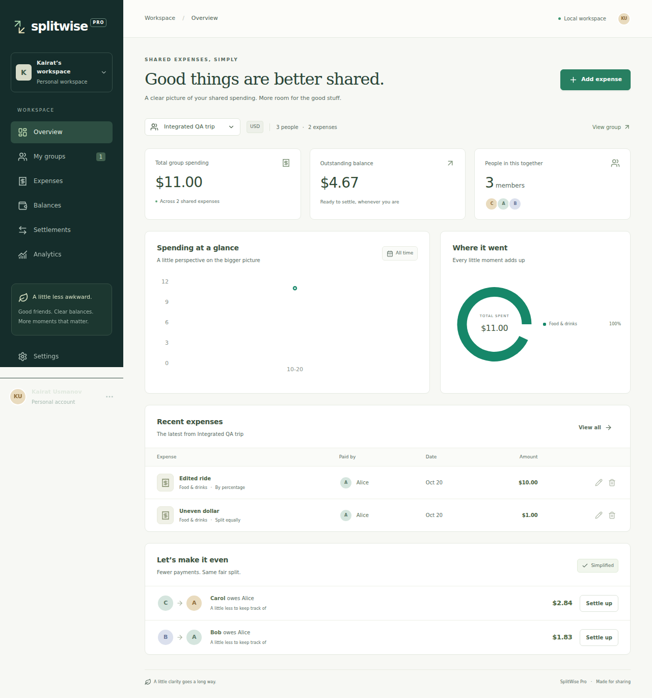

# SplitWise Pro

A local shared expense workspace for roommates, travel groups and events. Record equal, exact or percentage splits, inspect balances, record partial repayments and explore spending analytics. The app records settlements; it does not move money.



## Run locally

Prerequisites: Python 3.11+, Node.js 22+ and npm. Clone the repository and run all commands from its root. No account or API key is required.

### macOS / Linux

```sh
git clone https://github.com/Usmanovkairat/splitwise-pro.git
cd splitwise-pro
python3 -m venv .venv
.venv/bin/python -m pip install -r backend/requirements-lock.txt
npm --prefix frontend ci
.venv/bin/python -m alembic -c backend/alembic.ini upgrade head
.venv/bin/python -m uvicorn backend.app.main:app --host 127.0.0.1 --port 8000
```

Open a second terminal in the repository root:

```sh
npm --prefix frontend run dev -- --host 127.0.0.1
```

### Windows PowerShell

```powershell
git clone https://github.com/Usmanovkairat/splitwise-pro.git
cd splitwise-pro
py -3 -m venv .venv
.\.venv\Scripts\python.exe -m pip install -r backend/requirements-lock.txt
npm --prefix frontend ci
.\.venv\Scripts\python.exe -m alembic -c backend/alembic.ini upgrade head
.\.venv\Scripts\python.exe -m uvicorn backend.app.main:app --host 127.0.0.1 --port 8000
```

In a second PowerShell terminal, run `npm --prefix frontend run dev -- --host 127.0.0.1`.

Visit **http://127.0.0.1:5173**. The Vite development server proxies `/api` to the backend on port 8000. Interactive API documentation is at http://127.0.0.1:8000/docs. Stop both servers with Ctrl+C. SQLite records remain in `backend/splitwise.db`; migrate before first launch. Run one backend worker.

### Optional demonstration data

The normal workspace starts empty. With the backend stopped and **before creating any groups**, run:

```sh
.venv/bin/python -m backend.scripts.seed_demo
```

On Windows, replace `.venv/bin/python` with `.\.venv\Scripts\python.exe`. This explicit command creates an Almaty weekend group in KZT with four members, seven expenses and a partial repayment. It refuses to change a workspace that already contains a group. Restart the backend and refresh the frontend afterwards.

## Features and rules

- Create, rename and delete groups; add and remove members with reference protection.
- Create, edit and delete expenses; select payer, participants, category and date.
- Split equally, by exact amounts or percentages; inspect debt balances and deterministic repayment suggestions.
- Record partial settlements and review history; view category, timeline and individual contribution charts.
- Use responsive desktop/mobile views with validation, empty, loading and error states.
- Retain records through page refresh and backend restart using SQLAlchemy, SQLite and Alembic migrations.

Each group has one currency: KZT, USD, EUR or GBP. Money uses integer minor units; percentage allocations use basis points totaling 10000. Largest remainder rounding resolves ties by ascending member ID. Net balances sum to zero. Suggestions are deterministic but do not guarantee the globally smallest transfer count.

## Verification

Install dependencies as above, then run:

```sh
.venv/bin/python -m pytest backend/tests -q
.venv/bin/python -m openapi_spec_validator openapi.yml
npm --prefix frontend test
npm --prefix frontend run build
cd frontend
npx playwright install --with-deps chromium
npx playwright test
npx playwright test --config playwright.integration.config.ts
```

On Windows use `.\.venv\Scripts\python.exe` for the Python commands. Close development servers on ports 5173 and 8000 before browser tests. The integration runner creates and migrates a temporary SQLite database, starts both servers, and removes its database afterwards. Backend tests also use isolated databases and include a real backend process restart. `QA_PYTHON` can select another Python interpreter for the integration fixture.

On macOS/Linux, `make install`, `make migrate`, `make api`, `make web`, `make test`, `make contract`, `make build`, `make e2e` and `make e2e-integration` provide equivalent shortcuts. Run `api` and `web` in separate terminals.

GitHub Actions runs contract validation, backend/frontend tests, the frontend build, mock browser tests and the real SQLite browser workflow. Its actual hosted result is available in [Actions](https://github.com/Usmanovkairat/splitwise-pro/actions); test evidence and delivery status are recorded in [SUBMISSION.md](SUBMISSION.md).

Python installs use the committed `backend/requirements-lock.txt`, which pins direct and transitive project dependencies from the tested Python 3.12 environment. `backend/requirements.txt` retains the dependency-range specification for deliberate updates; regenerate the lock and rerun verification after changing it. Frontend dependency resolution uses `package-lock.json` with `npm ci`.

## Architecture and project evidence

React, TypeScript, Vite, Tailwind, Radix/shadcn-style components, React Router, TanStack Query, Recharts and Lucide form the frontend. FastAPI and Pydantic expose the REST API; SQLAlchemy 2 and Alembic manage persistence. `openapi.yml` is the source contract. Historical in-memory backend and deterministic frontend mock service remain available for tests and the documented iterations.

Use `VITE_SERVICE_MODE=mock` when starting Vite to demonstrate the frontend mock; the default is the real API. `VITE_API_BASE_URL` optionally overrides `/api`. Backend `DATABASE_URL` overrides the SQLite URL; `SPLITWISE_STORAGE=memory` selects volatile storage. See [backend instructions](backend/README.md) for details.

The application has no authentication and is intended for one local workspace. Bind it to localhost and run a single backend worker: the settlement lock is process-local. Cloud hosting, multi-user access, bank connections, exports and currency conversion remain outside the MVP. The production frontend build is verified, but a production hosting configuration is not included.

Read [the plan](_docs/plan.md), [architecture](_docs/architecture.md), [design system](_docs/design-system.md), [iteration record](_docs/iterations.md), [user testing](_docs/user-testing.md) and [genuine brainstorming record](chat-brainstorm.md). [Mobile screenshot](_docs/screenshots/integrated-mobile.png). Development uses real [GitHub Issues](https://github.com/Usmanovkairat/splitwise-pro/issues) and independent QA handoffs described in [AGENTS.md](AGENTS.md).
