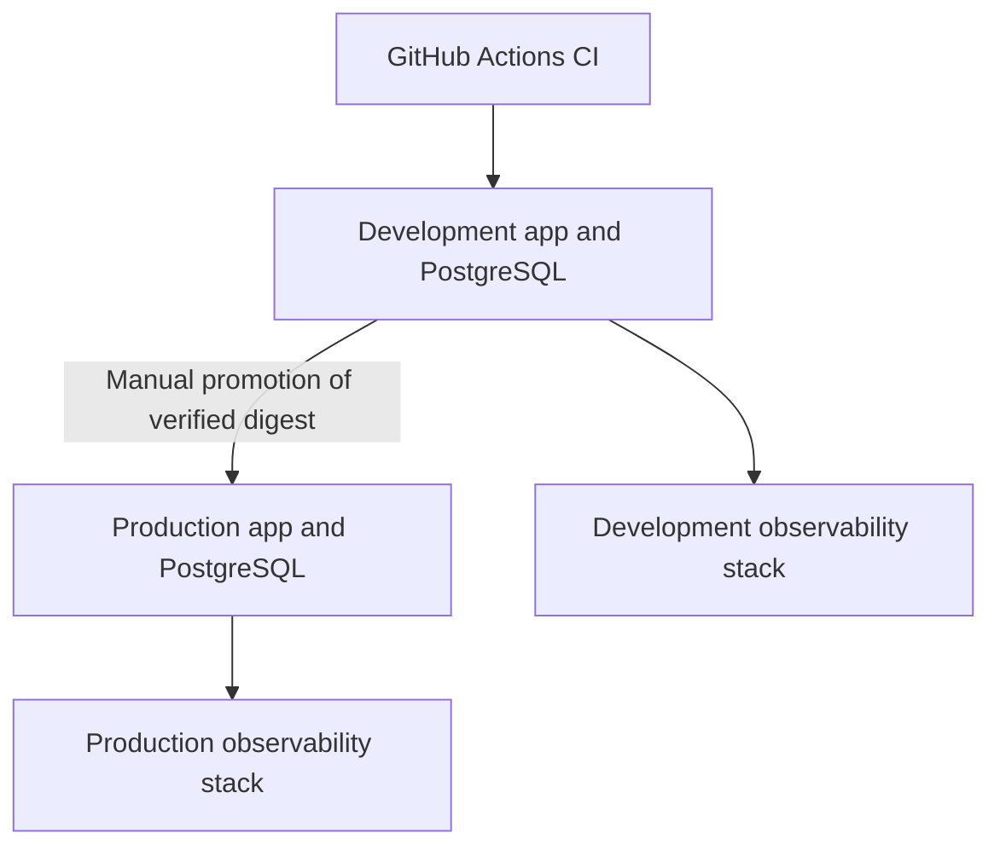
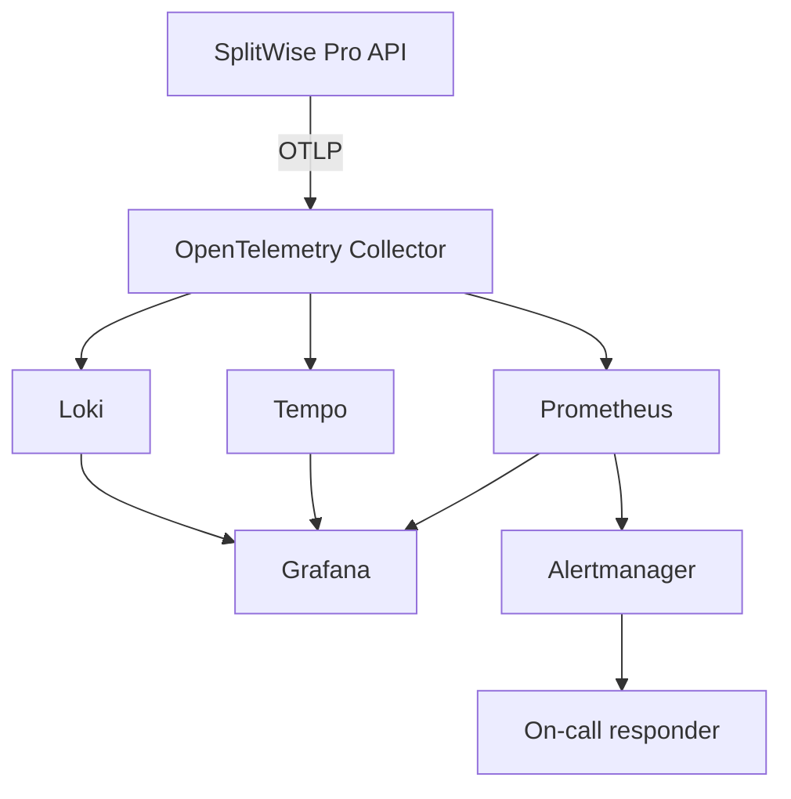

# SplitWise Pro — DevOps and observability

Start with [isolated environments](environments.md). Grafana provisions the **SplitWise Pro — Application Observability** dashboard. See [telemetry](opentelemetry.md), [metrics](metrics.md), [alerts](alerting.md), [AI on-call](ai-oncall.md), [incident response](incident-response.md), and [release promotion](manual-promotion.md).

Each environment runs this telemetry path independently.

The GitHub-hosted development deployment is disposable. For screenshots, use a running local deployment and capture the dashboard after generating traffic. See [audit](devops-audit.md) for the status inherited from the deployment assignment.
